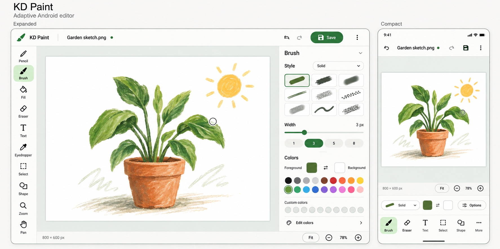
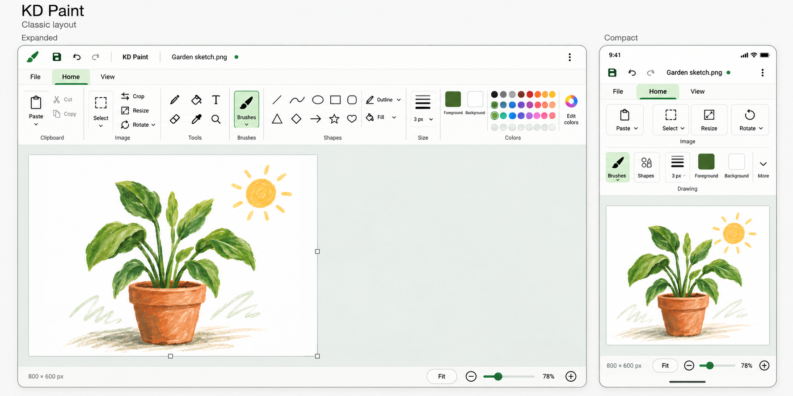
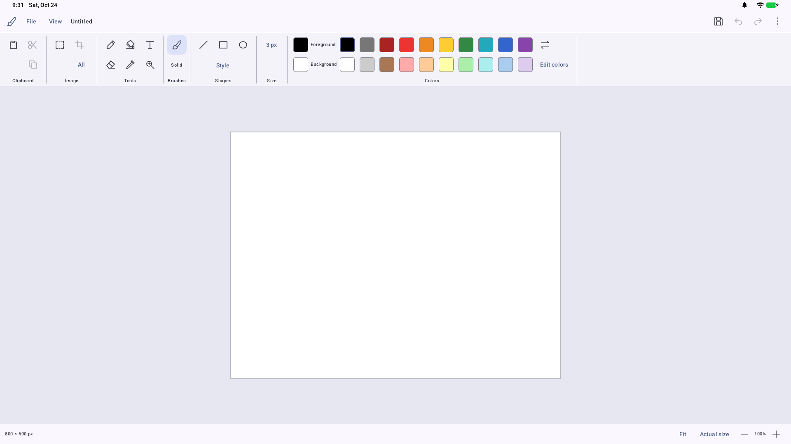

# KD Paint UI mockups

Created 24 October 2026 with the built-in image generation tool. Both layouts use
the same document and visual theme to make comparison easier.

## Modern layout

The light-theme mockup shows Material styling with the suite's green fallback
palette, an expanded tool strip and properties pane, and a compact editor with
bottom drawing controls. This is a historical concept for the Modern presentation
listed in the [roadmap](../../ROADMAP.md).

The complete [Modern generation prompt](android-ui-mockup-prompt.txt) is retained
for future revisions. The original image and prompt are preserved unchanged.

## Classic layout

This alternative uses a quick-access row, File/Home/View controls, and a top
ribbon grouping Clipboard, Image, Tools, Brushes, Shapes, Size, and Colors.
The canvas occupies the workspace beneath it. The phone version keeps commands
above the canvas and collapses galleries into accessible picker buttons.

The [Classic generation prompt](classic-ui-mockup-prompt.txt) uses the Modern image
as a visual/artwork reference and the
[reference specification](../../WINDOWS_7_PAINT_SPEC.md) for command placement.

Both generated images are preserved as historical layout concepts. The first
implementation used the Classic ribbon with two intentional changes: **no tabs
anywhere** (File/View are menus), and a **centered canvas**. The current editor
uses two drawing toolbars. The Classic phone mockup is not implemented; Modern
and shared mobile presentations remain deferred.

Use the [Paint guide](../../PAINT.md) for current behavior and
[Development](../../DEVELOPMENT.md) for constraints. The generated pixels are
layout references, not implementation requirements.

## Initial Classic implementation

Captured from the initial Android implementation on the API 37 desktop emulator at
1920 × 1080, density 160, with system dynamic colors. This is an app screenshot,
not a generated mockup. The new 800 × 600 image is centered at actual size, with
File/View menus and the permanent drawing ribbon above it. The white image is
independent of the surrounding appearance.
